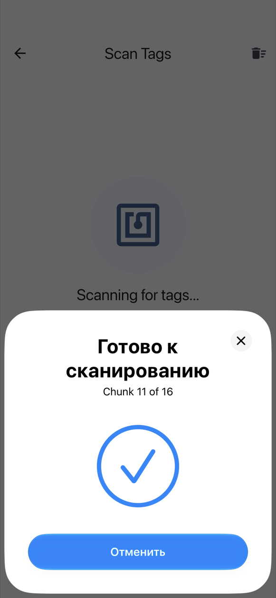
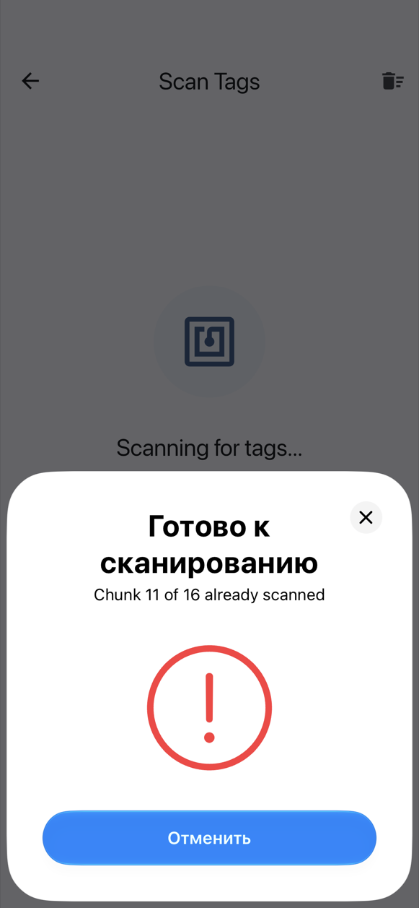

# On iPhone

The iPhone's own NFC writes and reads **NTAG213, NTAG215 and NTAG216** tags. Mifare Classic needs a [Chameleon Ultra](chameleon.md) (see below).

## One NFC sheet per tag

When you write or scan, iOS shows its NFC sheet at the bottom of the screen. NFC Archiver opens **a new sheet for each tag**:

1. Hold the top of the iPhone against the tag. The sheet reads (or writes) it and closes.
2. The way it closes tells you what happened:
    - a **checkmark** means the tag was read (or written) and its chunk is new;
    - a **red exclamation mark** means a duplicate (a chunk you already scanned) or a tag that could not be read.
3. Wait about **3 seconds**. The next sheet opens by itself; then hold the next tag.

{ width="260" }
{ width="260" }

A tag left resting on the phone is read only once, so you don't have to snatch it away.

While a sheet is open it covers the app, so the checkmark or exclamation mark, with its vibration, is your feedback. The app shows the details when the sheet closes.

## Stopping and resuming

- **Cancel** on the sheet stops scanning. To carry on, tap **Scan more tags** on the scan screen. Chunks already scanned are kept.
- The sheet **times out after 60 seconds** if no tag is presented. This also stops scanning; tap **Scan more tags** to resume.
- **Leaving the screen** (back, or swiping back) stops scanning or writing.

When writing, Cancel or the timeout takes you back to the "ready" state for the current tag, with no error: tap **Write to Tag** again.

## Mifare Classic

Mifare Classic is **impossible** with the iPhone's own NFC: Core NFC does not support the CRYPTO1 cipher those cards use, so the app does not offer Mifare Classic 1K under phone NFC on iPhone. With a [Chameleon Ultra](chameleon.md) connected over Bluetooth it can, because the reader does the cryptography itself. In that case Mifare Classic 1K appears in the tag type list.

## Share into NFC Archiver { #share-into-nfc-archiver }

In Photos or Files, tap **Share**, then **NFC Archiver**. A photo opens **Optimise photo**; any other file opens **Archive Settings**. If you share several items, only the first is used (the app tells you). If the app does not open by itself, open NFC Archiver and the shared item is picked up. If you are in the middle of writing an archive, the app asks **Start a new archive?** before discarding it. See [Archiving a photo](archive.md#archiving-a-photo) for the optimiser.

## Next

- [Archive a file](archive.md)
- [Restore a file](restore.md)
- [Troubleshooting](troubleshooting.md)
