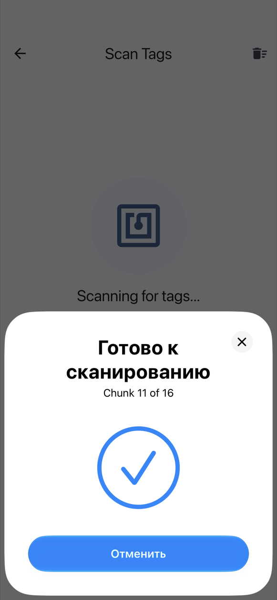
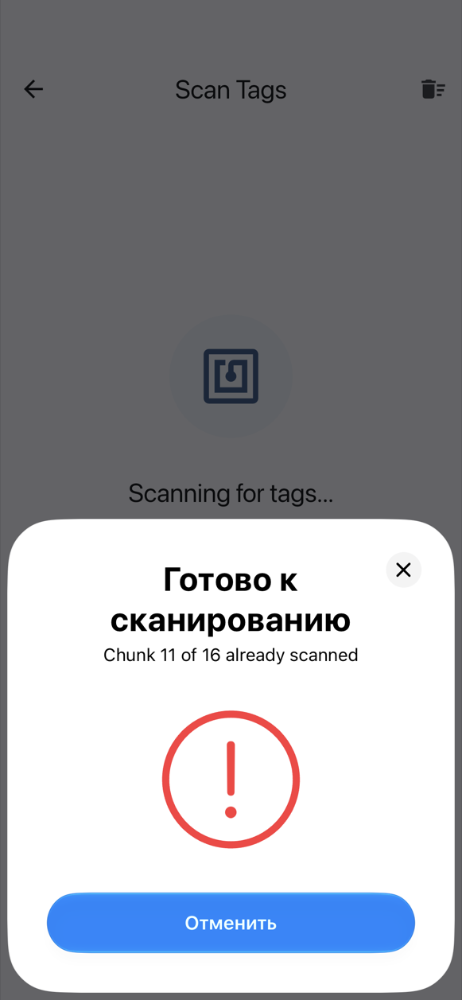

# iPhone-ზე

iPhone-ის ჩაშენებული NFC წერს და კითხულობს **NTAG213, NTAG215 და NTAG216** ტეგებს. Mifare Classic-ისთვის საჭიროა [Chameleon Ultra](chameleon.md) (იხ. ქვემოთ).

## ერთი NFC ფანჯარა თითო ტეგზე

ჩაწერისა და სკანირებისას iOS ეკრანის ქვედა ნაწილში საკუთარ NFC ფანჯარას აჩვენებს. NFC Archiver **თითოეული ტეგისთვის ახალ ფანჯარას** ხსნის:

1. მიადეთ iPhone-ის ზედა ნაწილი ტეგს. ფანჯარა წაიკითხავს (ან ჩაწერს) მას და დაიხურება.
2. იმის მიხედვით, თუ როგორ დაიხურა, ჩანს, რა მოხდა:
    - **ნიშანი ✓** ნიშნავს, რომ ტეგი წაკითხულია (ან ჩაწერილია) და მისი ნაწილი ახალია;
    - **წითელი ძახილის ნიშანი** ნიშნავს დუბლიკატს (ნაწილს, რომელიც უკვე დაასკანერეთ) ან ტეგს, რომლის წაკითხვაც ვერ მოხერხდა.
3. დაელოდეთ დაახლოებით **3 წამს**. შემდეგი ფანჯარა თავად გაიხსნება; მაშინ მიადეთ შემდეგი ტეგი.

{ width="260" }
{ width="260" }

ტელეფონზე დადებული ტეგი მხოლოდ ერთხელ იკითხება, ასე რომ, მისი სასწრაფოდ აღება საჭირო არ არის.

სანამ ფანჯარა ღიაა, ის აპს ფარავს, ამიტომ ნიშანი ✓ ან ძახილის ნიშანი ვიბრაციასთან ერთად არის თქვენი პასუხი. დეტალებს აპი ფანჯრის დახურვის შემდეგ აჩვენებს.

## შეჩერება და გაგრძელება

- ფანჯარაში **გაუქმება** აჩერებს სკანირებას. გასაგრძელებლად სკანირების ეკრანზე შეეხეთ **მეტი ტეგის სკანირება**-ს. უკვე დასკანერებული ნაწილები ინახება.
- თუ ტეგს არ მიადებთ, ფანჯარა **60 წამის შემდეგ იხურება**. ეს ასევე აჩერებს სკანირებას; გასაგრძელებლად შეეხეთ **მეტი ტეგის სკანირება**-ს.
- **ეკრანიდან გასვლა** (უკან ღილაკით ან ჟესტით) აჩერებს სკანირებას ან ჩაწერას.

ჩაწერისას გაუქმება ან დროის ამოწურვა შეცდომის გარეშე გაბრუნებთ მიმდინარე ტეგის ჩასაწერად მზადყოფნაში: კვლავ შეეხეთ **ტეგზე ჩაწერა**-ს.

## Mifare Classic

iPhone-ის ჩაშენებული NFC-ით Mifare Classic **შეუძლებელია**: Core NFC არ უჭერს მხარს CRYPTO1 შიფრს, რომელსაც ეს ბარათები იყენებს, ამიტომ iPhone-ზე ტელეფონის NFC-ით აპი Mifare Classic 1K-ს არ გთავაზობთ. Bluetooth-ით დაკავშირებული [Chameleon Ultra](chameleon.md)-ით ეს შესაძლებელია, რადგან კრიპტოგრაფიას თავად წამკითხველი ასრულებს. ამ შემთხვევაში Mifare Classic 1K ტეგების ტიპების სიაში ჩნდება.

## გაზიარება NFC Archiver-ში { #share-into-nfc-archiver }

Photos-ში ან Files-ში შეეხეთ **გაზიარება**-ს, შემდეგ **NFC Archiver**-ს. ფოტო **ფოტოს ოპტიმიზაცია** ეკრანს ხსნის; ნებისმიერი სხვა ფაილი — **არქივის პარამეტრები**-ს. რამდენიმე ელემენტის გაზიარებისას მხოლოდ პირველი გამოიყენება (აპი ამას გეტყვით). თუ აპი თავისით არ გაიხსნა, გახსენით NFC Archiver და გაზიარებული ელემენტი აიღება. თუ არქივის ჩაწერის შუაში ხართ, აპი გკითხავთ **დავიწყოთ ახალი არქივი?** მის გაუქმებამდე. ოპტიმიზატორისთვის იხილეთ [ფოტოს დაარქივება](archive.md#archiving-a-photo).

## შემდეგ

- [ფაილის დაარქივება](archive.md)
- [ფაილის აღდგენა](restore.md)
- [პრობლემების გადაჭრა](troubleshooting.md)
