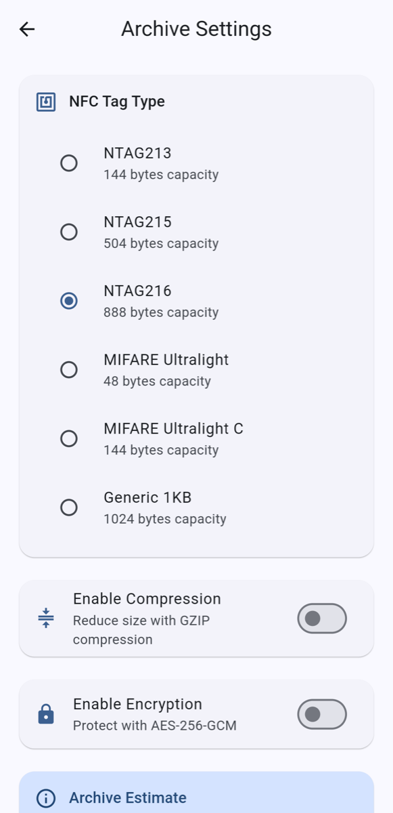
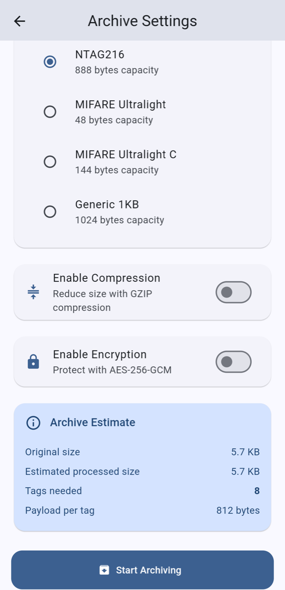
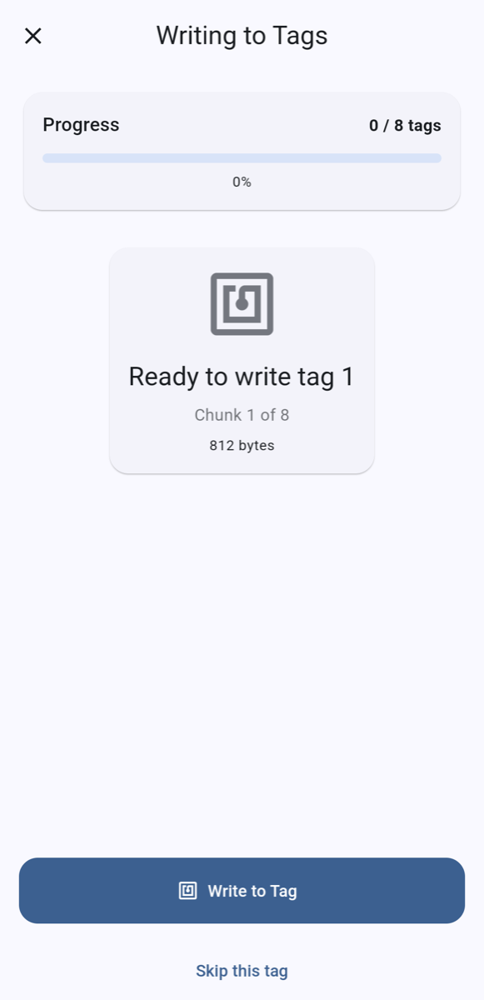

# Archiwizacja pliku

Archiwizacja dzieli plik na fragmenty i zapisuje po jednym fragmencie na każdy tag. Potrzebujesz tylu pustych (lub wielokrotnego zapisu) tagów, ile poda aplikacja.

## 1. Wybierz plik

Na ekranie głównym dotknij **Utwórz archiwum**. Wybierz **Plik** i dotknij, aby wybrać plik w systemowym oknie wyboru, albo wybierz **Tekst**, aby wpisać krótki tekst. Następnie dotknij **Konfiguruj archiwum**.

## Archiwizacja zdjęcia { #archiving-a-photo }

Na ekranie tworzenia archiwum stuknij **Wybierz zdjęcie** albo udostępnij zdjęcie z Zdjęć, Galerii lub Plików do NFC Archiver (udostępniony plik, który nie jest zdjęciem, od razu otwiera ustawienia archiwum). Jeśli udostępnisz kilka elementów, używany jest tylko pierwszy. Na iPhonie, jeśli aplikacja nie otworzy się sama po udostępnieniu, otwórz ją — zdjęcie zostanie podjęte.

Ekran **Optymalizuj zdjęcie** zmniejsza zdjęcie tak, by zmieściło się na Twoich tagach. W polu **Liczba tagów** ustaw, ile tagów może zająć zdjęcie; najlepsza jakość, która się na nich mieści, jest dobierana automatycznie. Aby samodzielnie ustawić rozmiar i jakość, wybierz je w sekcji **Ręcznie** (stuknij **Wróć do auto**, aby wrócić). Stuknij **Pomiń (zachowaj oryginał)**, aby zarchiwizować zdjęcie bez zmian, albo **Dalej**, aby przyjąć wynik.

Z zoptymalizowanego zdjęcia usuwane są dane o lokalizacji i aparacie.

## 2. Wybierz ustawienia

{ width="300" }
{ width="300" }

- **Typ tagu NFC**: rodzaj tagów, które będziesz zapisywać. Domyślnie wybrany jest NTAG216. Ile mieści każdy z nich, opisuje strona [Typy tagów](tag-types.md). Mifare Classic 1K pojawia się na liście tylko wtedy, gdy czytnik potrafi go zapisać (telefon z Androidem z obsługą Mifare albo [Chameleon Ultra](chameleon.md)).
- **Włącz kompresję** (opcjonalnie): kompresja GZIP. Jest stosowana tylko wtedy, gdy rzeczywiście zmniejsza dane; pliki już skompresowane, takie jak zdjęcia, filmy czy archiwa ZIP, prawie się nie zmniejszają.
- **Włącz szyfrowanie** (opcjonalnie): chroni archiwum szyfrem AES-256-GCM. Wpisz **Hasło**. Hasło nie jest nigdzie przechowywane: bez niego archiwum nie da się przywrócić, więc go nie zgub.

**Szacunek archiwum** na dole pokazuje, ilu tagów potrzebujesz (**Potrzebne tagi**) i ile bajtów trafi na każdy (**Dane na tag**). To szacunek: efekt kompresji jest przewidywany z góry.

Dotknij **Rozpocznij archiwizację**.

## 3. Zapisz tagi po kolei

{ width="300" }

Dla każdego tagu:

1. Dotknij **Zapisz na tag**.
2. Przyłóż tag do telefonu (na iPhonie, gdy pojawi się okno NFC; patrz [Na iPhonie](iphone.md)).
3. Poczekaj na **Tag zapisany!**, a potem zabierz tag.

Pasek postępu liczy zapisane tagi. Po ostatnim zobaczysz **Archiwizacja zakończona!**.

Tagi można później skanować w dowolnej kolejności, więc nie trzeba ich numerować. Trzymaj je jednak razem: do przywrócenia pliku potrzebny jest każdy tag.

!!! warning "Pomiń ten tag"
    **Pomiń ten tag** przechodzi do następnego fragmentu *bez zapisywania* bieżącego. Archiwum z pominiętym fragmentem nie da się przywrócić: pominiętego fragmentu nie można zapisać później. Aby uzyskać archiwum, które da się przywrócić, trzeba zarchiwizować plik ponownie od początku.

## Jeśli tag jest za mały { #if-a-tag-is-too-small }

Prawdziwe tagi czasem oferują nieco mniej miejsca, niż obiecuje ich typ. Jeśli tag nie pomieści fragmentu, aplikacja pokazuje **Tag za mały** z ilością miejsca na tagu i ilością potrzebną fragmentowi:

- Jeśli żaden tag nie został jeszcze zapisany, możesz dotknąć **Przekonfiguruj**: aplikacja podzieli dane na mniejsze fragmenty pasujące do tego tagu i poda, ile tagów jest teraz potrzebnych.
- W przeciwnym razie (lub jeśli wolisz) dotknij **Użyj innego tagu** i przyłóż większy tag.

Po zapisaniu pierwszego tagu archiwum nie można już przekonfigurować.

Jeśli przyłożysz tag innego rodzaju niż wybrany (na przykład kartę Mifare Classic przy wybranym NTAG216), aplikacja to zgłosi; wróć i zmień **Typ tagu NFC**.
