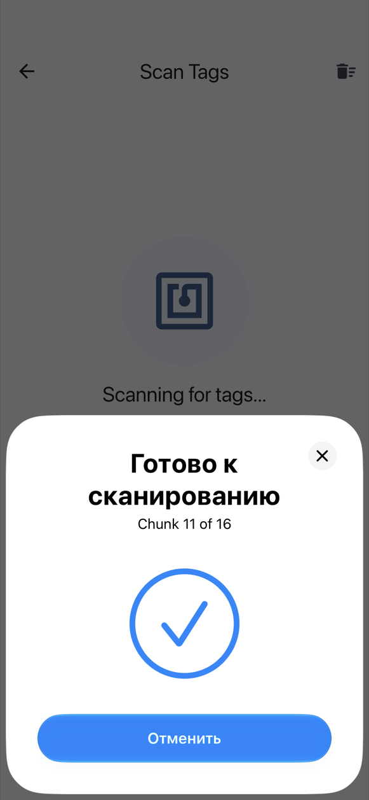
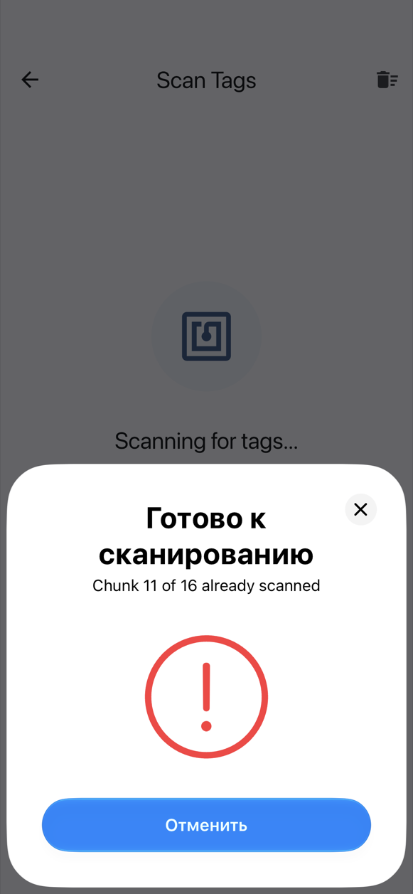

# Na iPhonie

Wbudowane NFC iPhone'a zapisuje i odczytuje tagi **NTAG213, NTAG215 i NTAG216**. Do Mifare Classic potrzebny jest [Chameleon Ultra](chameleon.md) (patrz niżej).

## Jedno okno NFC na każdy tag

Podczas zapisu i skanowania iOS pokazuje na dole ekranu własne okno NFC. NFC Archiver otwiera **nowe okno dla każdego tagu**:

1. Przyłóż górną część iPhone'a do tagu. Okno odczyta (lub zapisze) tag i się zamknie.
2. Sposób zamknięcia mówi, co się stało:
    - **znaczek ✓** oznacza, że tag został odczytany (lub zapisany), a jego fragment jest nowy;
    - **czerwony wykrzyknik** oznacza duplikat (fragment, który już zeskanowano) albo tag, którego nie udało się odczytać.
3. Odczekaj około **3 sekund**. Następne okno otworzy się samo; wtedy przyłóż kolejny tag.

{ width="260" }
{ width="260" }

Tag pozostawiony na telefonie jest odczytywany tylko raz, więc nie trzeba go w pośpiechu zabierać.

Gdy okno jest otwarte, zasłania aplikację, więc znaczek ✓ lub wykrzyknik z wibracją to Twoja informacja zwrotna. Szczegóły aplikacja pokaże po zamknięciu okna.

## Zatrzymywanie i wznawianie

- **Anuluj** w oknie zatrzymuje skanowanie. Aby kontynuować, dotknij **Skanuj więcej tagów** na ekranie skanowania. Zeskanowane już fragmenty zostają zachowane.
- Jeśli nie przyłożysz tagu, okno **zamyka się po 60 sekundach**. To również zatrzymuje skanowanie; dotknij **Skanuj więcej tagów**, aby wznowić.
- **Opuszczenie ekranu** (przyciskiem wstecz lub gestem) zatrzymuje skanowanie lub zapis.

Podczas zapisu Anuluj lub upływ czasu przywracają gotowość do zapisu bieżącego tagu, bez błędu: dotknij ponownie **Zapisz na tag**.

## Mifare Classic

Z wbudowanym NFC iPhone'a Mifare Classic jest **niemożliwe**: Core NFC nie obsługuje szyfru CRYPTO1, którego używają te karty, więc przy NFC telefonu na iPhonie aplikacja nie oferuje Mifare Classic 1K. Z [Chameleonem Ultra](chameleon.md) połączonym przez Bluetooth jest to możliwe, bo kryptografię wykonuje sam czytnik. Wtedy Mifare Classic 1K pojawia się na liście typów tagów.

## Udostępnianie do NFC Archiver { #share-into-nfc-archiver }

W Zdjęciach lub Plikach dotknij **Udostępnij**, potem **NFC Archiver**. Zdjęcie otwiera **Optymalizuj zdjęcie**; każdy inny plik otwiera **Ustawienia archiwum**. Jeśli udostępnisz kilka elementów, używany jest tylko pierwszy (aplikacja o tym informuje). Jeśli aplikacja nie otworzy się sama, otwórz NFC Archiver — udostępniony element zostanie podjęty. Jeśli jesteś w trakcie zapisywania archiwum, aplikacja zapyta **Rozpocząć nowe archiwum?**, zanim je odrzuci. O optymalizatorze zobacz [Archiwizacja zdjęcia](archive.md#archiving-a-photo).

## Dalej

- [Archiwizacja pliku](archive.md)
- [Przywracanie pliku](restore.md)
- [Rozwiązywanie problemów](troubleshooting.md)
