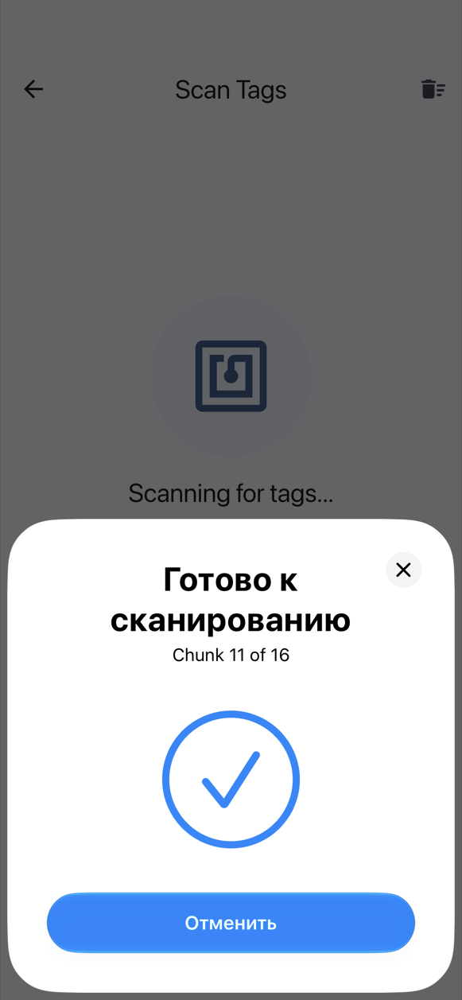
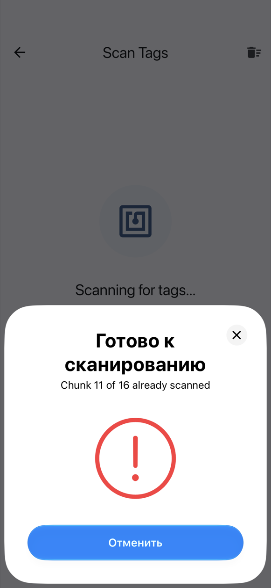

# На iPhone

Встроенный NFC iPhone записывает и читает метки **NTAG213, NTAG215 и NTAG216**. Для Mifare Classic нужен [Chameleon Ultra](chameleon.md) (см. ниже).

## Одно окно NFC на каждую метку

При записи и сканировании iOS показывает внизу экрана своё окно NFC. NFC Archiver открывает **новое окно для каждой метки**:

1. Приложите верхнюю часть iPhone к метке. Окно прочитает (или запишет) её и закроется.
2. По тому, как оно закрылось, видно, что произошло:
    - **галочка** — метка прочитана (или записана), и её чанк новый;
    - **красный восклицательный знак** — дубликат (чанк, который вы уже сканировали) или метка, которую не удалось прочитать.
3. Подождите около **3 секунд**. Следующее окно откроется само; тогда прикладывайте следующую метку.

{ width="260" }
{ width="260" }

Метка, оставленная лежать на телефоне, читается только один раз, так что убирать её в спешке не нужно.

Пока окно открыто, оно закрывает приложение, поэтому галочка или восклицательный знак с вибрацией — это и есть ответ. Подробности приложение покажет, когда окно закроется.

## Остановка и продолжение

- **Отмена** в окне останавливает сканирование. Чтобы продолжить, нажмите **Сканировать ещё метки** на экране сканирования. Уже отсканированные чанки сохраняются.
- Если метку не приложить, окно **закрывается через 60 секунд**. Это тоже останавливает сканирование; нажмите **Сканировать ещё метки**, чтобы продолжить.
- **Уход с экрана** (кнопкой «назад» или жестом) останавливает сканирование или запись.

При записи «Отмена» или тайм-аут возвращают к готовности записать текущую метку, без ошибки: снова нажмите **Записать на метку**.

## Mifare Classic

Со встроенным NFC iPhone Mifare Classic **невозможен**: Core NFC не поддерживает шифр CRYPTO1, который используют эти карты, поэтому при NFC телефона на iPhone приложение не предлагает Mifare Classic 1K. С [Chameleon Ultra](chameleon.md), подключённым по Bluetooth, это возможно: криптографию выполняет сам считыватель. Тогда Mifare Classic 1K появляется в списке типов меток.

## Отправка в NFC Archiver { #share-into-nfc-archiver }

В «Фото» или «Файлах» нажмите **Поделиться**, затем **NFC Archiver**. Фото открывает **Оптимизация фото**; любой другой файл открывает **Настройки архива**. Если отправить несколько объектов, используется только первый (приложение сообщает об этом). Если приложение не открылось само, откройте NFC Archiver — отправленный объект будет подхвачен. Если вы в середине записи архива, приложение спросит **Начать новый архив?**, прежде чем его отбросить. Об оптимизации см. [Архивация фото](archive.md#archiving-a-photo).

## Дальше

- [Архивация файла](archive.md)
- [Восстановление файла](restore.md)
- [Решение проблем](troubleshooting.md)
