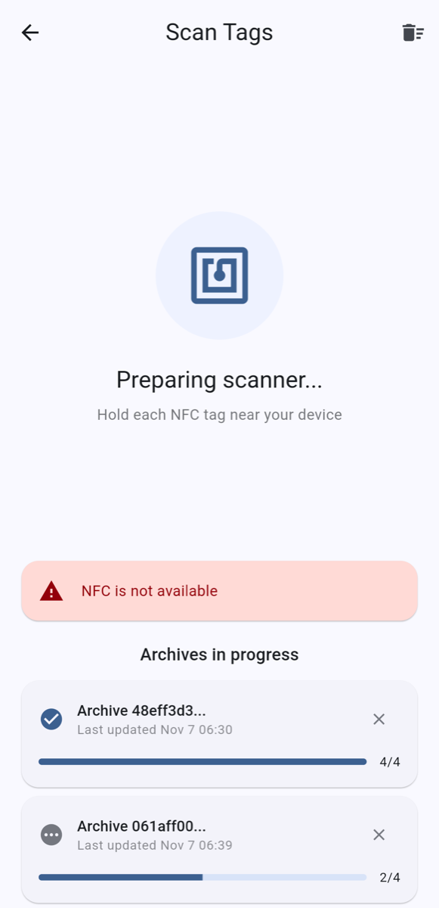
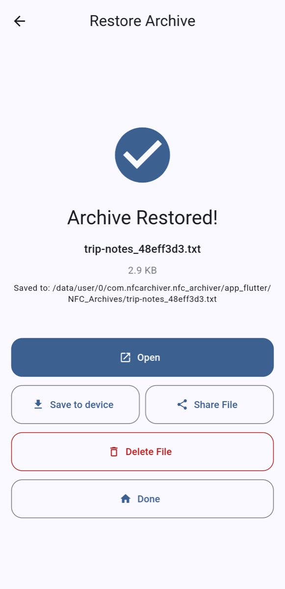

# Dosya geri yükleme

Geri yüklemek için bir arşivin tüm etiketlerini tarayın. Sıra önemli değildir.

## 1. Etiketleri tarayın

Ana ekranda **Arşivi Geri Yükle**'ye dokunun. **Etiketleri Tara** ekranı açılır ve tarama başlar.

{ width="300" }

*NFC'si olmayan bir emülatörde alındı, uyarı bu yüzden görünüyor. Alttaki iki arşiv ekran görüntüsü için hazırlandı.*

Her etiketi sırayla telefona tutun (iPhone'da etiket başına bir NFC penceresi; bkz. [iPhone'da](iphone.md)):

- Yeni bir etiket **Yeni parça bulundu!** ve numarasını gösterir, örneğin "Parça 3 / 8".
- Zaten taradığınız bir etiket **Yinelenen parça** gösterir ve yok sayılır. iPhone'da pencere bir çarpıyla ve "Parça 3 / 8 zaten tarandı" mesajıyla kapanır.

**Devam eden arşivler**, taramaya başladığınız her arşivi ve etiketlerinden kaçının elinizde olduğunu (örneğin 2/4) listeler. İlerlemeniz kaydedilir: çıkıp kalan etiketleri taramak için daha sonra dönebilirsiniz. Farklı arşivlerin etiketleri karışık taranabilir; her biri kendi arşivine gider.

Bitmemiş bir arşivi listeden kaldırmak için ✕ simgesine dokunun. Üstteki çöp kutusu simgesi hepsini temizler.

## 2. Geri yükleyin

Son etiket de tarandığında uygulama **Tüm parçalar alındı!** gösterir.

- **Dosya adı** (isteğe bağlı): özgün adı kullanmak için boş bırakın.
- Arşiv şifreliyse ("Bu arşiv şifrelenmiş") **Şifre**'yi girin.

**Arşivi Geri Yükle**'ye dokunun. Önce bir şey daha taramak isterseniz **Daha fazla etiket tara** sizi geri götürür.

**Devam eden arşivler** listesindeki tamamlanmış bir arşive (onay işaretli) dokunarak da buraya gelebilirsiniz.

## 3. Geri yüklenen dosyayı kullanın

{ width="300" }

**Arşiv Geri Yüklendi!** dosya adını gösterir. Farklı arşivlerden gelen dosyalar birbirinin üzerine yazmasın diye ada arşiv kimliğinin kısa bir bölümü eklenir. Dosya uygulamanın içinde saklanır; diğer uygulamalar onu göremez. Kullanmak için:

- **Aç**, dosyayı bu türü açabilen bir uygulamada açar.
- **Cihaza kaydet**, sistemin kaydetme penceresini (varsayılan olarak İndirilenler) açar; böylece uygulamanın dışında bir kopya tutabilirsiniz.
- **Dosyayı Paylaş**, dosyayı başka bir uygulamaya gönderir.

Geri yüklenen dosyalar ana ekrandaki **Arşivlenmiş Dosyalar** altında da listelenir. Metin arşivi, metni doğrudan ve kopyalama düğmesiyle gösterir.

## Bir şeyler ters giderse

- **Yanlış şifre**: uygulama (İngilizce olarak) "Decryption failed: wrong password or corrupted data" der. **Farklı Şifre Dene**'ye dokunun ve şifreyi yeniden girin.
- **Veri Bozulması Tespit Edildi**: bir etiketin parçası sağlama toplamı (CRC) denetiminden geçemedi. **1 Etiketi Yeniden Tara**'ya (sayı değişir) dokunun ve listelenen etiketleri yeniden tarayın; iyi bir okuma bozuk olanın yerini alır.

Daha fazlası için [Sorun giderme](troubleshooting.md).
