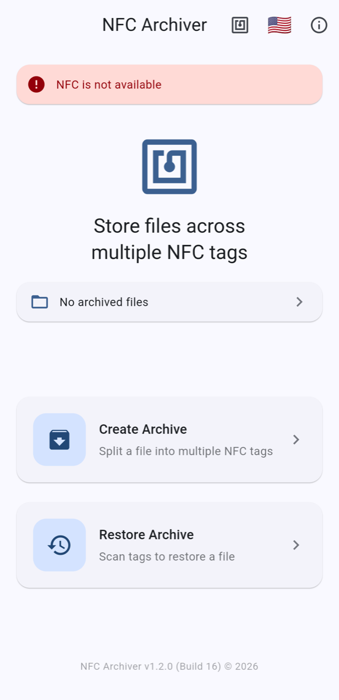

# На Android

Телефон на Android з NFC напряму записує і читає мітки **NTAG213, NTAG215 і NTAG216**. **Mifare Classic 1K** він теж може записувати й читати напряму, але лише якщо його NFC-чип підтримує Mifare Classic (функція NXP Mifare). Так уміють не всі телефони: у багатьох NFC-чипів інших виробників її немає.

Застосунок перевіряє це сам. Якщо телефон не вміє працювати з Mifare Classic, **Mifare Classic 1K** просто немає у списку типів міток. [Chameleon Ultra](chameleon.md) додає його на будь-якому телефоні.

{ width="300" }

*Головний екран (знімки англійською). Знімок зроблено в емуляторі без NFC, тому видно попередження «NFC недоступний».*

## Перед початком

- **Увімкніть NFC** у налаштуваннях телефону. Якщо NFC вимкнено (або його немає), на головному екрані написано **NFC недоступний**.
- **Знайдіть антену.** Де розташована антена NFC, залежить від телефону; у багатьох моделей — на задній панелі, ближче до верху. Якщо нічого не відбувається, повільно поводіть міткою по задній панелі телефону.
- Тримайте мітку нерухомо, поки застосунок не відреагує. Мітка, прибрана посеред запису чи читання, — найчастіша причина збою.

## Як це працює на Android

Системного вікна на Android немає: перебіг роботи показує екран самого застосунку.

- Під час **запису** натисніть **Записати на мітку** і прикладіть мітку до телефону. **Мітку записано!** підтверджує запис. Приберіть мітку і знову натисніть **Записати на мітку** для наступної.
- Під час **сканування** прикладайте мітки одну за одною. Кожна нова показує **Знайдено новий чанк!**; уже відсканована — **Дублікат чанку**.

Якщо прикласти картку Mifare Classic до телефону без її підтримки, застосунок повідомить (поки англійською): "This looks like a Mifare Classic card. Your phone's NFC chip can't read them." («Схоже, це картка Mifare Classic. NFC-чіп вашого телефону не може їх читати.»)

## Далі

- [Архівація файлу](archive.md)
- [Відновлення файлу](restore.md)
- [Типи міток](tag-types.md)
