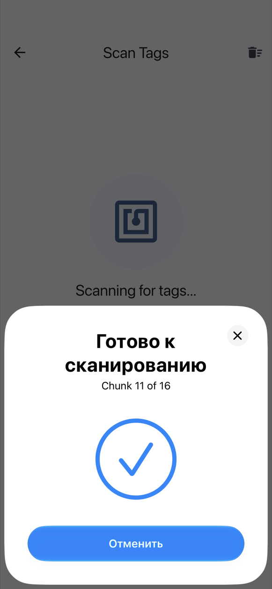
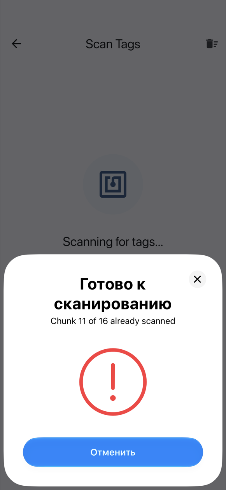

# На iPhone

Вбудований NFC iPhone записує і читає мітки **NTAG213, NTAG215 і NTAG216**. Для Mifare Classic потрібен [Chameleon Ultra](chameleon.md) (див. нижче).

## Одне вікно NFC на кожну мітку

Під час запису й сканування iOS показує внизу екрана своє вікно NFC. NFC Archiver відкриває **нове вікно для кожної мітки**:

1. Прикладіть верхню частину iPhone до мітки. Вікно прочитає (або запише) її і закриється.
2. З того, як воно закрилося, видно, що сталося:
    - **галочка** — мітку прочитано (або записано), і її чанк новий;
    - **червоний знак оклику** — дублікат (чанк, який ви вже сканували) або мітка, яку не вдалося прочитати.
3. Зачекайте близько **3 секунд**. Наступне вікно відкриється саме; тоді прикладайте наступну мітку.

{ width="260" }
{ width="260" }

Мітка, що лишилася лежати на телефоні, читається лише один раз, тож прибирати її поспіхом не треба.

Поки вікно відкрите, воно закриває застосунок, тому галочка чи знак оклику із вібрацією — це і є відповідь. Подробиці застосунок покаже, коли вікно закриється.

## Зупинка і продовження

- **Скасувати** у вікні зупиняє сканування. Щоб продовжити, натисніть **Сканувати ще мітки** на екрані сканування. Уже відскановані чанки зберігаються.
- Якщо мітку не прикласти, вікно **закривається через 60 секунд**. Це теж зупиняє сканування; натисніть **Сканувати ще мітки**, щоб продовжити.
- **Вихід з екрана** (кнопкою «назад» чи жестом) зупиняє сканування або запис.

Під час запису «Скасувати» чи тайм-аут повертають до готовності записати поточну мітку, без помилки: знову натисніть **Записати на мітку**.

## Mifare Classic

З вбудованим NFC iPhone Mifare Classic **неможливий**: Core NFC не підтримує шифр CRYPTO1, який використовують ці картки, тому з NFC телефону на iPhone застосунок не пропонує Mifare Classic 1K. З [Chameleon Ultra](chameleon.md), підключеним через Bluetooth, це можливо: криптографію виконує сам зчитувач. Тоді Mifare Classic 1K з'являється у списку типів міток.

## Надсилання в NFC Archiver { #share-into-nfc-archiver }

У «Фото» або «Файлах» торкніться **Поділитися**, потім **NFC Archiver**. Фото відкриває **Оптимізація фото**; будь-який інший файл відкриває **Налаштування архіву**. Якщо надіслати кілька елементів, використовується лише перший (застосунок повідомляє про це). Якщо застосунок не відкрився сам, відкрийте NFC Archiver — надісланий елемент буде підхоплено. Якщо ви посеред запису архіву, застосунок запитає **Почати новий архів?**, перш ніж його відкинути. Про оптимізацію див. [Архівація фото](archive.md#archiving-a-photo).

## Далі

- [Архівація файлу](archive.md)
- [Відновлення файлу](restore.md)
- [Усунення проблем](troubleshooting.md)
